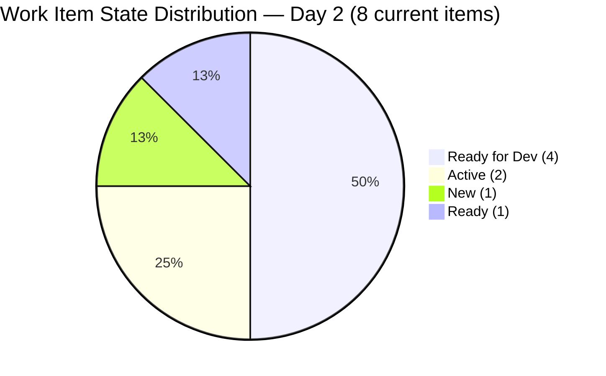
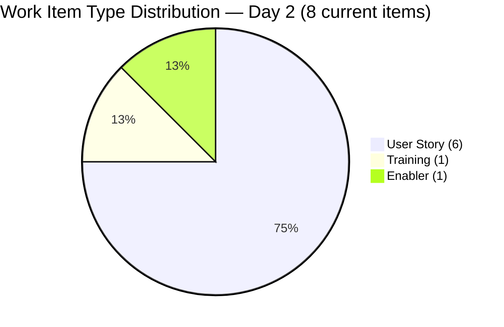
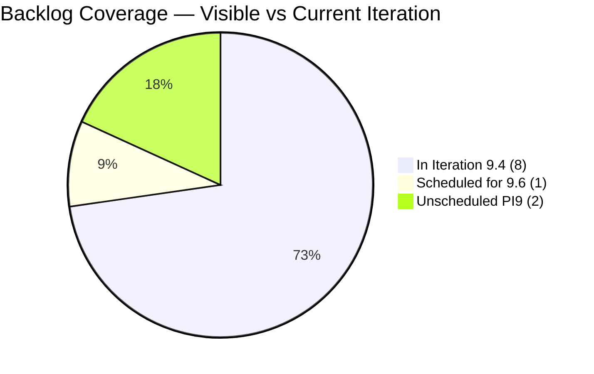
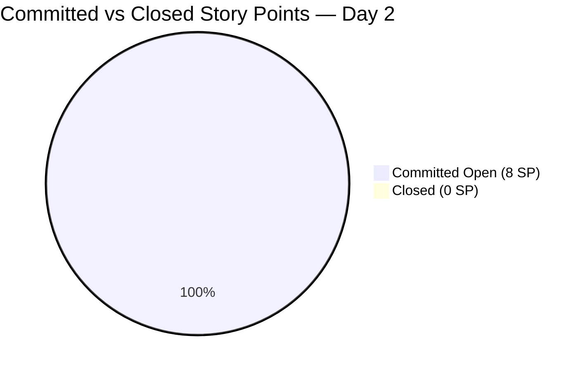

# SAFe Iteration Audit — Human Resource Recruitment Team

## 1. Audit Metadata

| Field | Value |
|-------|-------|
| **Project** | Jairosoft FINOPS |
| **Project ID** | `e0bb302f-40f9-46c3-8164-6f1acb317d63` |
| **Team** | Human Resource Recruitment Team |
| **Team ID** | `248f59a6-372c-4b74-8129-9eaf260f211e` |
| **Workspace** | `ado_hr` |
| **Iteration** | Iteration 9.4 |
| **Iteration ID** | `9205c6ba-a811-479c-9e68-d7bd96c0cc6b` |
| **Iteration Dates** | 2026-11-02 to 2026-11-15 |
| **Audit Date** | 2026-11-03 (Day 2 of 14) — Philippine Standard Time (UTC+8) |
| **Prior Audit Reference** | `audit/AUDIT_20260627_0920.md` — Iteration 7.6 IP Day 13, Score 72.9 |
| **Overall Score** | **74.7 / 100** |
| **Risk Band** | MODERATE (Yellow) |

---

## 2. Executive Summary

The Human Resource Recruitment Team opens **Day 2 of 14** of Iteration 9.4 (Nov 2–Nov 15, 2026) with an overall score of **74.7 (Moderate)**. The audit resumes after a 4-month gap since the last recorded audit (Jun 27, 2026, Iteration 7.6 IP).

Three dimensions score at 100.0: **Team Capacity**, **Estimation**, and **DoR Compliance** — the strongest simultaneous performance on these three in the audit series. Almera Kleer Tayao is the sole active contributor, now fully configured with 5 pts/day capacity (Documentation 3.0 + Requirements 2.0), eliminating the chronic Team Capacity deficit seen in PI7.

The sprint carries **8 root backlog items** assigned to Iteration 9.4 out of 11 total visible backlog items, yielding an Iteration Planning score of 72.7. Three items (208833, 211761, 211995) remain unassigned to the current iteration. Work Item Balance holds at 70.0 due to User Story dominance (75%). Backlog Refinement is 80.0 — a -20 early-sprint penalty applies because 5 of 8 current-iteration items were last modified before the iteration start date (Oct 31 prep work).

**Delivery Predictability is 0.0** — expected on Day 2 of 14. Early-sprint context applies; no closures are anticipated this early. All 8 committed items total 8 SP, all in Ready for Dev, Active, or Ready state. Almera's demonstrated burst capacity (23 SP in a single day, PI6.5) means full delivery remains achievable.

Key structural concern: 3 unscheduled backlog items (208833, 211761, 211995) remain in the PI9 backlog without iteration assignment. These represent potential scope creep or backlog hygiene gaps that should be scheduled or removed before the mid-sprint point.

No iteration goal is defined for 9.4 — a persistent gap across all audits.

---

## 3. Previous Audit Delta

> **Note:** The prior audit (AUDIT_20260627_0920.md) covers Iteration 7.6 IP (Jun 15–28, 2026). The current audit covers Iteration 9.4 (Nov 2–15, 2026), representing a different PI and sprint. Scores are not directly comparable to 7.6 IP due to different iteration content and scope. PI8 and earlier 9.x iterations were not audited; this audit re-establishes the baseline for PI9 work.

| Dimension | Prior (Jun 27, 2026 — Iter 7.6 IP) | Current (Nov 3, 2026 — Iter 9.4) | Delta | Note |
|-----------|----------------------|--------------------------|-------|------|
| Iteration Planning | 100.0 | **72.7** | -27.3 | 3 backlog items not yet in current iteration |
| Team Capacity | 50.0 | **100.0** | +50.0 | Almera fully configured; solo contributor resolved ✅ |
| Estimation | 96.7 | **100.0** | +3.3 | All 8 items estimated at 1 SP ✅ |
| DoR Compliance | 93.3 | **100.0** | +6.7 | All 8 items fully compliant ✅ |
| Work Item Balance | 70.0 | **70.0** | 0 | US dominance structural; same penalty applies |
| Backlog Refinement | 100.0 | **80.0** | -20.0 | 5/8 items untouched since pre-sprint (Oct 31 prep) |
| Delivery Predictability | 0.0 | **0.0** | 0 | Day 2 of 14 — early-sprint; no closures expected |
| **Overall** | **72.9** | **74.7** | **+1.8** | Marginal improvement; TC and DoR fully resolved |

---

## 4. Current Iteration Snapshot

| Field | Value |
|-------|-------|
| **Iteration** | 9.4 |
| **Start Date** | 2026-11-02 |
| **End Date** | 2026-11-15 |
| **Day in Sprint** | Day 2 of 14 |
| **Days Remaining** | 12 |
| **Total Visible Root Backlog Items** | 11 |
| **Root Items in Current Iteration (9.4)** | 8 |
| **Root Items NOT in Current Iteration** | 3 (208833 → 9.6; 211761, 211995 → PI9 unassigned) |
| **Closed Items** | 0 |
| **Active Items** | 2 (211991, 212012) |
| **Ready for Dev Items** | 4 (211164, 212013, 212014, 212017) |
| **Ready Items** | 1 (212016) |
| **New Items** | 1 (212045) |
| **Story Points Committed** | 8 SP (all 8 items at 1 SP each) |
| **Story Points Closed** | 0 SP |
| **Iteration Goal** | Not defined |

### 4.1 Current Iteration Items (8 items)

| ID | Title | Type | State | SP | Assignee | Changed | Desc | AC |
|----|-------|------|-------|-----|----------|---------|------|-----|
| 211164 | Jairosoft Employees Pickleball Open Play | User Story | Ready for Dev | 1.0 | Almera | Oct 31 | ✅355 | ✅4255 |
| 211991 | Luke's 3rd Month Evaluation Result | User Story | Active | 1.0 | Almera | Oct 31 | ✅3807 | ✅3674 |
| 212012 | Jairosoft Employees Pickleball Open Play | User Story | Active | 1.0 | Almera | Oct 31 | ✅2159 | ✅3367 |
| 212013 | Jairosoft Employees Pickleball Open Play | User Story | Ready for Dev | 1.0 | Almera | Nov 2 | ✅2169 | ✅4189 |
| 212014 | Jairosoft Employees Pickleball Open Play | User Story | Ready for Dev | 1.0 | Almera | Nov 2 | ✅463 | ✅5039 |
| 212016 | Onboarding Session w/ HR & JIT CSS Trainer | Training | Ready | 1.0 | Almera | Oct 31 | ✅310 | ✅658 |
| 212017 | Collection of 201 Files of JIT CSS Trainers | User Story | Ready for Dev | 1.0 | Almera | Nov 3 | ✅1410 | ✅997 |
| 212045 | Jairosoft Employees Pickleball Open Play | Enabler | New | 1.0 | Almera | Oct 31 | ✅1946 | ✅4301 |

### 4.2 Unscheduled Backlog Items (3 items, NOT in current iteration)

| ID | Title | Type | State | SP | Current Iteration | Changed |
|----|-------|------|-------|-----|-------------------|---------|
| 208833 | Regularization of Luke Colina | User Story | New | 2.0 | 9.6 (future) | Sep 21 |
| 211761 | Leadership Training | User Story | New | null | PI9 (no iter) | Oct 8 |
| 211995 | JIT CSS Trainer - Donal Macasampon | User Story | New | null | PI9 (no iter) | Oct 19 |

### 4.3 Contributor Summary

| Contributor | Items (Current Iter) | Capacity (ADO) | Status |
|-------------|---------------------|----------------|--------|
| Almera Kleer Tayao | 8 | 5 pts/day (Doc 3.0 + Req 2.0) | Sole contributor — fully configured ✅ |
| grace | 0 | Not configured | Non-contributor this iteration |

---

## 5. Work Item Analysis

### 5.1 Items by State (8 current-iteration items)

| State | Count | Items |
|-------|-------|-------|
| Ready for Dev | 4 | 211164, 212013, 212014, 212017 |
| Active | 2 | 211991, 212012 |
| New | 1 | 212045 |
| Ready | 1 | 212016 |
| Closed | 0 | — |

### 5.2 Items by Type

| Type | Count | Items | Dominant? |
|------|-------|-------|-----------|
| User Story | 6 | 211164, 211991, 212012, 212013, 212014, 212017 | Yes (75%) |
| Training | 1 | 212016 | — |
| Enabler | 1 | 212045 | — |
| Spike | 0 | — | — |

### 5.3 Estimation Coverage

| Category | Count | SP Total |
|----------|-------|----------|
| Estimated (SP > 0) | 8 | 8 SP |
| Unestimated (SP = 0 or null) | 0 | 0 SP |
| **Total** | **8** | **8 SP** |

### 5.4 DoR Compliance — Full Assessment

All 8 current-iteration items satisfy Definition of Ready (Description ≥ 30 non-whitespace chars AND Acceptance Criteria ≥ 20 non-whitespace chars):

| ID | Description (chars) | AC (chars) | DoR Status |
|----|---------------------|------------|------------|
| 211164 | 355 | 4255 | ✅ PASS |
| 211991 | 3807 | 3674 | ✅ PASS |
| 212012 | 2159 | 3367 | ✅ PASS |
| 212013 | 2169 | 4189 | ✅ PASS |
| 212014 | 463 | 5039 | ✅ PASS |
| 212016 | 310 | 658 | ✅ PASS |
| 212017 | 1410 | 997 | ✅ PASS |
| 212045 | 1946 | 4301 | ✅ PASS |

### 5.5 Pickleball Event Cluster (211164, 212012, 212013, 212014, 212045)

Five items share the title prefix "Jairosoft Employees Pickleball Open Play" under different IDs. These appear to represent distinct user stories or sub-activities for the same event initiative, split into separate work items. All 5 are assigned to Almera, all estimated at 1 SP, and all are DoR-compliant. They represent 62.5% of the sprint (5 SP). The clustering of similar-titled items suggests the work may benefit from consolidation or clearer sub-title differentiation for backlog clarity.

### 5.6 Task Hierarchy

Each of the 8 root items has task children (confirmed via iteration API):
- 211164 → 9 tasks (211165–211173): Pickleball shirt size collection, supplier contact, tally
- 211991 → 5 tasks (212005–212009): PAF follow-up, evaluation meeting
- 212012 → 4 tasks (212038–212041): Budget proposal compilation and submission
- 212013 → 3 tasks (212042–212044): Davao shirt sizes collection and submission
- 212014 → 4 tasks (212046–212049): Cebu shirt sizes collection
- 212016 → 4 tasks (212054–212057): Onboarding session scheduling and kit preparation
- 212017 → 4 tasks (212373–212376): 201 file collection for CSS trainers
- 212045 → 3 tasks (212090–212092): Layout approval, Cebu dispatch

Total task items: 36 child tasks across 8 root items — excluded from scoring per rubric.

---

## 6. SAFe Compliance Scorecard

| Dimension | Score | Formula | Evidence |
|-----------|-------|---------|----------|
| Iteration Planning | **72.7** | (8/11) × 100 | 8 of 11 visible backlog items in Iteration 9.4; 3 items unscheduled |
| Team Capacity | **100.0** | (1/1) × 100 | Almera configured 5 pts/day; only 1 contributor with active work |
| Estimation | **100.0** | (8/8) × 100 | All 8 current items have SP = 1.0 |
| DoR Compliance | **100.0** | (8/8) × 100 | All 8 items have Desc ≥ 30 + AC ≥ 20 |
| Work Item Balance | **70.0** | 100 − 30 | User Story = 75% > 60% threshold → −30 dominant-type penalty |
| Backlog Refinement | **80.0** | 100 − 20 | All 11 fresh (last 45 days); 5/8 current items untouched since Oct 31 (62.5% > 30%) → −20 |
| Delivery Predictability | **0.0** | (0/8) × 100 | 0 SP closed; Day 2 of 14 — **early-sprint, low delivery expected** |
| **Overall** | **74.7** | Sum / 7 | **MODERATE (Yellow)** |

---

## 7. Dimension Findings

### 7.1 Iteration Planning — 72.7 (Moderate)

8 of 11 visible backlog items are committed to Iteration 9.4. Three items remain outside the current iteration:

- **208833** (Regularization of Luke Colina, User Story, 2 SP) is assigned to Iteration 9.6 (future). This is intentional forward-planning, but it remains in the visible backlog and affects the denominator.
- **211761** (Leadership Training, User Story, null SP) and **211995** (JIT CSS Trainer - Donal Macasampon, User Story, null SP) are assigned to the PI9 parent path without a specific iteration, indicating unscheduled backlog items. Both have null SP and no description or AC (DoR gap), making them candidates for grooming or removal.

Scheduling 211761 and 211995 to Iteration 9.4 or a future 9.x iteration would improve Iteration Planning in subsequent audits. The 72.7 score signals modest planning discipline at sprint entry — acceptable but improvable.

### 7.2 Team Capacity — 100.0 (Strong ✅ — Resolved)

Almera Kleer Tayao is the sole contributor with active work in Iteration 9.4. She is fully configured in ADO with 5 pts/day capacity (Documentation: 3.0 pts/day + Requirements: 2.0 pts/day). This is the first time Team Capacity reaches 100.0 in the PI9 audit window — a significant improvement from the chronic 50.0 scores in PI7 due to Mark Colina's missing capacity entry. Grace remains unconfigured but holds no items this sprint.

Bus factor remains 1 (all 8 items owned by Almera), but this is a structural team composition issue, not a scoring deficiency here.

### 7.3 Estimation — 100.0 (Strong ✅)

All 8 current-iteration items carry Story Points = 1.0. There are no unestimated items. This is the first 100.0 Estimation score in this audit series, eliminating the recurring spike/defect unestimated item problem seen in PI6 and PI7.

Note: The 1 SP uniform allocation across all items (including a Training and an Enabler) may warrant review during refinement — uniform SP estimates sometimes indicate estimation was not rigorously sized per item complexity. Not a scoring deficiency, but worth raising in retrospective.

### 7.4 DoR Compliance — 100.0 (Strong ✅)

All 8 current-iteration items fully satisfy the Definition of Ready: Description ≥ 30 non-whitespace characters and Acceptance Criteria ≥ 20 non-whitespace characters. Several items carry exceptionally detailed AC (212014: 5039 chars, 212013: 4189 chars). This resolves the persistent DoR failures (207044, 207047) that plagued PI7 audits and was flagged for 4+ consecutive audits.

### 7.5 Work Item Balance — 70.0 (Moderate — Structural Penalty)

User Stories constitute 6 of 8 items (75%), triggering the dominant-type penalty (−30) since the 60% threshold is exceeded. Non-User Story types: 1 Training (212016) and 1 Enabler (212045). No Spikes are present; no User Story absence penalty applies.

The 75% User Story share is contextually appropriate for an HR team running operational people-management and event-coordination work. The structural penalty reflects type concentration that is inherent to the team's function, not poor planning. Introducing a Spike or additional enabler work would mechanically reduce the penalty but is not warranted here unless actual spike/research work exists.

### 7.6 Backlog Refinement — 80.0 (Good — Early-Sprint Untouched Penalty)

All 11 visible backlog items were last modified within 45 days (earliest: 208833 on Sep 21, 43 days ago — within threshold). Zero stale_90 items, zero stale_180 items.

However, 5 of 8 current-iteration items (211164, 211991, 212012, 212016, 212045) were last changed on Oct 31, 2026 — two days before the iteration started Nov 2. Per the rubric, items whose `ChangedDate` is earlier than the iteration start date are counted as "untouched." This yields 5/8 = 62.5% untouched, exceeding the 30% threshold and triggering the −20 penalty.

**Early-sprint context:** Oct 31 modifications are likely pre-sprint preparation activity (backlog grooming, item setup before the sprint kick-off). This is expected behavior at Day 2. These items are not truly neglected — they were actively prepared two days ago. Three items were modified on or after the iteration start (212013: Nov 2, 212014: Nov 2, 212017: Nov 3), indicating early-sprint engagement. The penalty is mechanically correct but contextually benign at this stage. The score should improve as items are touched during the sprint.

### 7.7 Delivery Predictability — 0.0 (Day 2 of 14 — Early Sprint)

Zero Story Points closed at Day 2 of a 14-day sprint. **This is expected.** The rubric requires annotation: *early-sprint — low delivery expected.*

Committed: 8 SP across 8 items. All are in pre-active or active states (Ready for Dev, Active, Ready, New). Delivery window spans 12 remaining days.

Historical reference: Almera achieved 23 SP in a single day during PI6 Iteration 6.5 (Mar 18, 2026). With 12 days remaining and 8 SP committed, full delivery is achievable. The 4 "Ready for Dev" items (211164, 212013, 212014, 212017) and 1 "Ready" item (212016) represent the fastest-path closures — all are DoR-compliant and estimated.

| Target | SP to close | Days available | Feasibility |
|--------|-------------|----------------|-------------|
| 50% (4 SP) | 4 | 12 | Very High |
| 75% (6 SP) | 6 | 12 | High |
| 100% (8 SP) | 8 | 12 | High — ≤1 SP/day avg needed |

---

## 8. Risks and Bottlenecks

| Risk | Severity | Details |
|------|----------|---------|
| Bus Factor = 1 | HIGH | All 8 items owned by Almera Kleer Tayao. Single absence blocks all delivery. Structural — unchanged across audit series. |
| 3 Unscheduled Backlog Items | MODERATE | 211761 and 211995 have null SP, no description, no AC, and no iteration assignment. These are backlog hygiene gaps. 208833 is future-scheduled (9.6) but sits in the visible backlog. |
| Delivery Predictability at 0.0 | MODERATE | Expected at Day 2, but requires consistent closure velocity through Day 14. Late-sprint burst pattern (visible in PI7) should be avoided in PI9. |
| Uniform 1 SP Estimation | LOW | All 8 items rated at 1 SP each. Potential estimation shortcut — not all activities are equally complex. May cause capacity planning inaccuracies if sizing is not revisited in refinement. |
| No Iteration Goal | MODERATE | No iteration goal defined for 9.4 — persistent across all PI7 and PI9 audits (15+ consecutive audits). Limits team alignment and sprint focus. |
| Pickleball Cluster (5 items, 5 SP) | LOW | 5 items sharing "Pickleball" in the title suggest sub-activities of one event. Naming clarity (e.g., "Pickleball Open Play — Shirt Survey", "— Budget Proposal") would improve traceability without scoring impact. |

---

## 9. Prioritized Recommendations

| Priority | Action | Owner | Target |
|----------|--------|-------|--------|
| P0 | Begin closing Ready-for-Dev items by Day 5 to establish delivery momentum early (avoid PI7 late-burst pattern). Start with 212017 (201 Files collection) or 212013/212014 (Cebu/Davao shirt sizes). | Almera | Day 3–5 |
| P1 | Schedule 211761 (Leadership Training) and 211995 (JIT CSS Trainer - Donal) to a specific iteration or de-commit them. Both lack SP, description, and AC. | Ramon/Almera | Day 3 |
| P1 | Add description and AC to 211761 and 211995 if keeping them in PI9. Each requires less than 10 minutes. | Almera | Day 3–5 |
| P2 | Define an iteration goal for 9.4 — one sentence capturing the sprint theme (e.g., "Complete Pickleball event prep and new-joiner onboarding"). | Ramon | Day 1–3 |
| P2 | Differentiate the 5 Pickleball sub-item titles to improve backlog clarity (no scoring impact but aids tracking). | Almera | Any day |
| P3 | Review the uniform 1 SP estimate across all 8 items during mid-sprint refinement — validate that Training (212016) and Enabler (212045) are correctly sized relative to User Stories. | Ramon/Almera | Day 6–7 |
| P3 | Retrospective: Establish mid-sprint check-in by Day 7 to verify delivery progress and avoid last-day closures. | Ramon | Day 7 |

---

## 10. Evidence Gaps and Limitations

| Gap | Impact | Status |
|-----|--------|--------|
| 4-month audit gap (Jun 27 – Nov 3) | No PI8 or early PI9 data available. Score trajectory since Jul 2026 is unknown. | Documented. This audit re-establishes the PI9 baseline. |
| Team membership (Grace) | Grace is a team member with 0 capacity and 0 items. Capacity not configured. No scoring impact since she holds no work. | Informational only. |
| Items 211761, 211995 — No description or AC | Both fail DoR but are NOT in the current iteration → excluded from DoR scoring denominator. Scoring is not affected; backlog hygiene is. | Documented. |
| Closed items detection | Like prior PI6/PI7 audits, closed items may drop from the backlog API view. Any closures during Iteration 9.4 will be captured on the next audit cycle or via iteration API. | Low risk at Day 2. |
| Pickleball items: multiple IDs, same title | Five items sharing near-identical titles (211164, 212012, 212013, 212014, 212045) could represent duplicates or deliberate sub-stories. Not verifiable from API data alone. | Noted. No scoring impact. |

---

## Appendix: Visualizations

```mermaid
bar
    title SAFe Dimension Scores — HR Team Iteration 9.4, Day 2 (2026-11-03)
    x-axis [Iter Plan, Team Cap, Estimation, DoR, WI Balance, Backlog Ref, Delivery]
    y-axis "Score (0–100)" 0 --> 100
    bar [72.7, 100, 100, 100, 70, 80, 0]
```









```mermaid
xychart-beta
    title Audit Score Trend — ado_hr (Selected Points)
    x-axis ["Mar 22 (6.5)", "Jun 27 (7.6 IP)", "Nov 3 (9.4)"]
    y-axis "Overall Score" 0 --> 100
    line [80, 72.9, 74.7]
```
