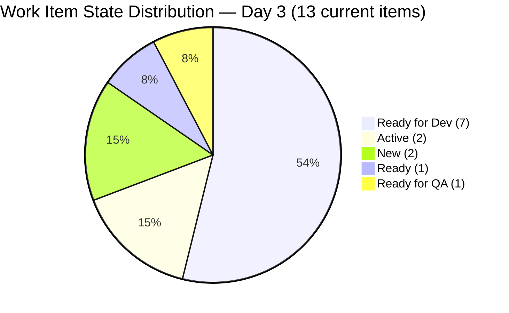
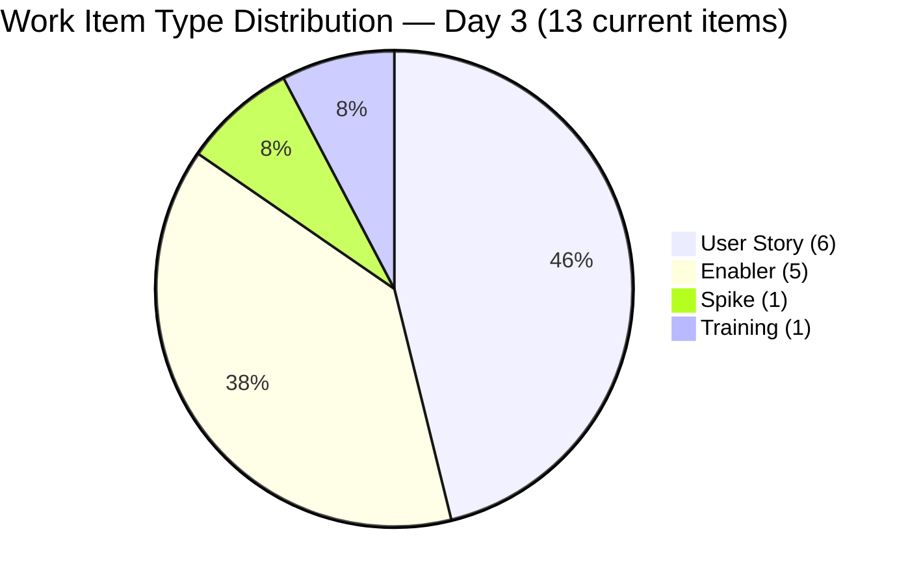
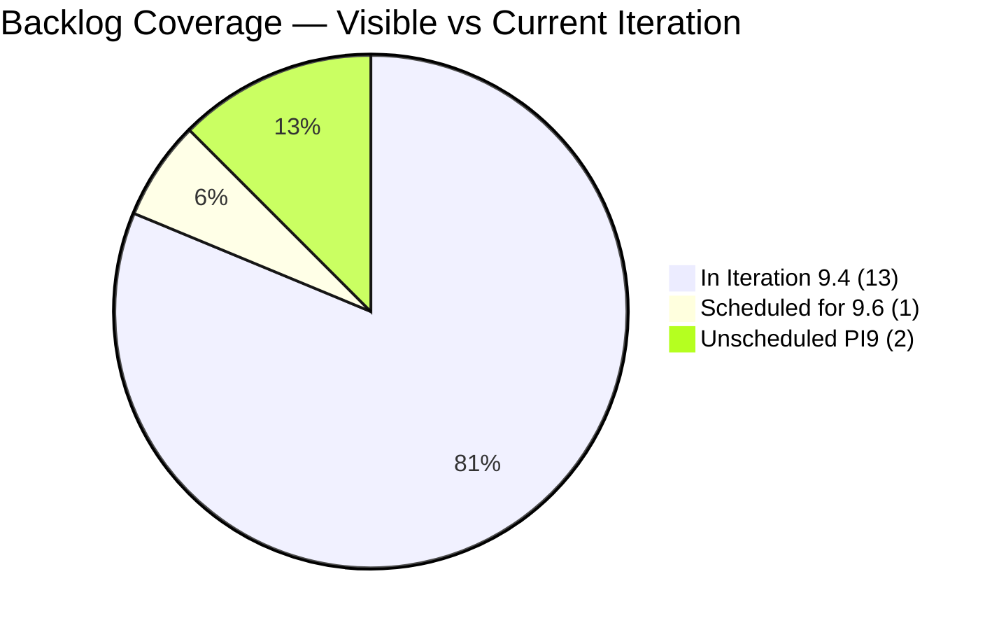
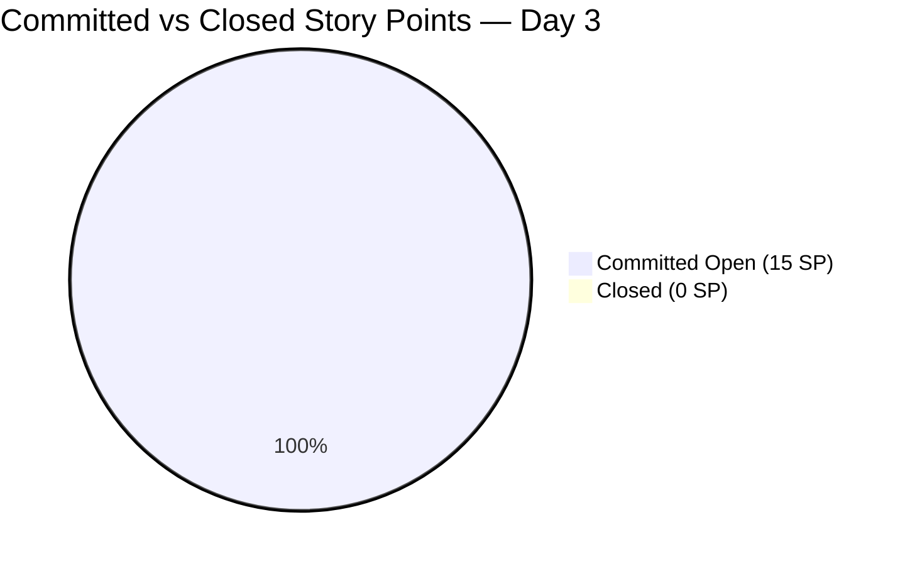

# SAFe Iteration Audit — Human Resource Recruitment Team

## 1. Audit Metadata

| Field | Value |
|-------|-------|
| **Project** | Jairosoft FINOPS |
| **Project ID** | `e0bb302f-40f9-46c3-8164-6f1acb317d63` |
| **Team** | Human Resource Recruitment Team |
| **Team ID** | `248f59a6-372c-4b74-8129-9eaf260f211e` |
| **Workspace** | `ado_hr` |
| **Iteration** | Iteration 9.4 |
| **Iteration ID** | `9205c6ba-a811-479c-9e68-d7bd96c0cc6b` |
| **Iteration Dates** | 2026-11-02 to 2026-11-15 |
| **Audit Date** | 2026-11-04 (Day 3 of 14) — Philippine Standard Time (UTC+8) |
| **Prior Audit Reference** | `audit/AUDIT_20261103_0915.md` — Iteration 9.4 Day 2, Score 74.7 (Moderate) |
| **Overall Score** | **80.2 / 100** |
| **Risk Band** | LOW (Green) ✅ |

---

## 2. Executive Summary

The Human Resource Recruitment Team enters **Day 3 of 14** of Iteration 9.4 (Nov 2–Nov 15, 2026) with an overall score of **80.2 (Low Risk)** — crossing the SAFe target threshold for the first time in PI9. This is a **+5.5 point improvement** over yesterday's Day 2 score of 74.7 (Moderate).

The score breakthrough is driven by a significant sprint scope expansion: **5 new items were added today** (212422, 212423, 212424, 212425, 212426 — all assigned to Iteration 9.4), bringing the current-iteration item count from 8 to 13 and committed story points from 8 SP to 15 SP. The addition of 4 Enablers and 1 Spike reduced User Story type concentration from 75% to 46.2%, eliminating the Work Item Balance dominant-type penalty and lifting that dimension from 70.0 to 100.0.

Three dimensions remain at 100.0: **Team Capacity**, **Estimation**, and **DoR Compliance**. All 13 current-iteration items are fully estimated and DoR-compliant; Almera Kleer Tayao continues as sole contributor with 5 pts/day capacity. Backlog Refinement holds at 80.0 — the same early-sprint untouched penalty applies (5 of 13 items last modified Oct 31, before the iteration start). Delivery Predictability is 0.0 at Day 3 of 14, which is fully expected.

Three unscheduled backlog items (208833, 211761, 211995) remain from yesterday, unchanged. The visible backlog grew from 11 to 16 items; Iteration Planning improves to 81.3 (13/16) from 72.7 (8/11).

No iteration goal is defined — a persistent gap across all audits.

---

## 3. Previous Audit Delta

| Dimension | Prior (Nov 3, 2026 — Day 2) | Current (Nov 4, 2026 — Day 3) | Delta | Note |
|-----------|----------------------|--------------------------|-------|------|
| Iteration Planning | 72.7 | **81.3** | +8.6 | 5 new items added to iteration (13/16 vs 8/11) |
| Team Capacity | 100.0 | **100.0** | 0 | Almera fully configured; stable ✅ |
| Estimation | 100.0 | **100.0** | 0 | All 13 items estimated ✅ |
| DoR Compliance | 100.0 | **100.0** | 0 | All 13 items compliant ✅ |
| Work Item Balance | 70.0 | **100.0** | +30.0 | US dominance fell from 75% → 46.2% (5 non-US items added) |
| Backlog Refinement | 80.0 | **80.0** | 0 | Same Oct 31 untouched penalty; new items touch-dated today |
| Delivery Predictability | 0.0 | **0.0** | 0 | Day 3 of 14 — early-sprint; no closures expected |
| **Overall** | **74.7** | **80.2** | **+5.5** | **Crosses LOW RISK threshold ✅** |

---

## 4. Current Iteration Snapshot

| Field | Value |
|-------|-------|
| **Iteration** | 9.4 |
| **Start Date** | 2026-11-02 |
| **End Date** | 2026-11-15 |
| **Day in Sprint** | Day 3 of 14 |
| **Days Remaining** | 11 |
| **Total Visible Root Backlog Items** | 16 |
| **Root Items in Current Iteration (9.4)** | 13 |
| **Root Items NOT in Current Iteration** | 3 (208833 → 9.6; 211761, 211995 → PI9 unassigned) |
| **Closed Items** | 0 |
| **Active Items** | 2 (211991, 212012) |
| **Ready for Dev Items** | 7 (211164, 212013, 212014, 212017, 212422, 212423, 212425) |
| **Ready for QA Items** | 1 (212424) |
| **Ready Items** | 1 (212016) |
| **New Items** | 2 (212045, 212426) |
| **Story Points Committed** | 15 SP |
| **Story Points Closed** | 0 SP |
| **Iteration Goal** | Not defined |

### 4.1 Current Iteration Items (13 items)

| ID | Title | Type | State | SP | Assignee | Changed | Desc | AC |
|----|-------|------|-------|-----|----------|---------|------|-----|
| 211164 | Pickleball Open Play \| Event Shirt Sizing | User Story | Ready for Dev | 1.0 | Almera | Oct 31 | ✅277 | ✅457 |
| 211991 | Luke's 3rd Month Evaluation Result | User Story | Active | 1.0 | Almera | Oct 31 | ✅530 | ✅637 |
| 212012 | Pickleball Open Play \| Budget Approval | User Story | Active | 1.0 | Almera | Oct 31 | ✅265 | ✅471 |
| 212013 | Pickleball Open Play \| Tshirt Procurement (Davao) | User Story | Ready for Dev | 1.0 | Almera | Nov 2 | ✅277 | ✅587 |
| 212014 | Pickleball Open Play \| Tshirt Procurement (Cebu) | User Story | Ready for Dev | 1.0 | Almera | Nov 2 | ✅302 | ✅721 |
| 212016 | Onboarding Session w/ HR & JIT CSS Trainer | Training | Ready | 1.0 | Almera | Oct 31 | ✅303 | ✅622 |
| 212017 | Collection of 201 Files of JIT CSS Trainers | User Story | Ready for Dev | 1.0 | Almera | Nov 3 | ✅307 | ✅688 |
| 212045 | Pickleball Open Play \| Tshirt Printing & Dispatch | Enabler | New | 1.0 | Almera | Oct 31 | ✅291 | ✅708 |
| 212422 | Setup Meeting w/ Bomar & Grace re: Luke's Employment Status | Enabler | Ready for Dev | 1.0 | Almera | Nov 4 | ✅321 | ✅528 |
| 212423 | 2027 Leave Policy | Enabler | Ready for Dev | 1.0 | Almera | Nov 4 | ✅417 | ✅981 |
| 212424 | 2026 Sick Leave Conversion | Enabler | Ready for QA | 2.0 | Almera | Nov 4 | ✅482 | ✅581 |
| 212425 | HR Connect - Sprint 9.4 | Enabler | Ready for Dev | 1.0 | Almera | Nov 4 | ✅303 | ✅529 |
| 212426 | CADAC - Letter Submission and Scheduling | Spike | New | 2.0 | Almera | Nov 4 | ✅350 | ✅535 |

### 4.2 New Items Added Today (5 items, added Nov 4)

| ID | Title | Type | State | SP |
|----|-------|------|-------|----|
| 212422 | Setup Meeting w/ Bomar & Grace re: Luke's Employment Status | Enabler | Ready for Dev | 1.0 |
| 212423 | 2027 Leave Policy | Enabler | Ready for Dev | 1.0 |
| 212424 | 2026 Sick Leave Conversion | Enabler | Ready for QA | 2.0 |
| 212425 | HR Connect - Sprint 9.4 | Enabler | Ready for Dev | 1.0 |
| 212426 | CADAC - Letter Submission and Scheduling | Spike | New | 2.0 |

### 4.3 Unscheduled Backlog Items (3 items, NOT in current iteration — unchanged from Day 2)

| ID | Title | Type | State | SP | Current Iteration | Changed |
|----|-------|------|-------|-----|-------------------|---------|
| 208833 | Regularization of Luke Colina | User Story | New | 2.0 | 9.6 (future) | Sep 21 |
| 211761 | Leadership Training | User Story | New | null | PI9 (no iter) | Oct 8 |
| 211995 | JIT CSS Trainer - Donal Macasampon | User Story | New | null | PI9 (no iter) | Oct 19 |

### 4.4 Contributor Summary

| Contributor | Items (Current Iter) | Capacity (ADO) | Status |
|-------------|---------------------|----------------|--------|
| Almera Kleer Tayao | 13 | 5 pts/day (Doc 3.0 + Req 2.0) | Sole contributor — fully configured ✅ |
| Grace | 0 | Not configured | Non-contributor this iteration |

---

## 5. Work Item Analysis

### 5.1 Items by State (13 current-iteration items)

| State | Count | Items |
|-------|-------|-------|
| Ready for Dev | 7 | 211164, 212013, 212014, 212017, 212422, 212423, 212425 |
| Active | 2 | 211991, 212012 |
| New | 2 | 212045, 212426 |
| Ready | 1 | 212016 |
| Ready for QA | 1 | 212424 |
| Closed | 0 | — |

### 5.2 Items by Type

| Type | Count | Items | Dominant? |
|------|-------|-------|-----------|
| User Story | 6 | 211164, 211991, 212012, 212013, 212014, 212017 | No (46.2%) |
| Enabler | 5 | 212045, 212422, 212423, 212424, 212425 | — |
| Spike | 1 | 212426 | — |
| Training | 1 | 212016 | — |

### 5.3 Estimation Coverage

| Category | Count | SP Total |
|----------|-------|----------|
| Estimated (SP > 0) | 13 | 15 SP |
| Unestimated (SP = 0 or null) | 0 | 0 SP |
| **Total** | **13** | **15 SP** |

> Note: 212424 (Sick Leave Conversion) carries 2 SP; 212426 (CADAC) carries 2 SP. Remaining 11 items all at 1 SP.

### 5.4 DoR Compliance — Full Assessment

All 13 current-iteration items satisfy the Definition of Ready (Description ≥ 30 non-whitespace chars AND Acceptance Criteria ≥ 20 non-whitespace chars):

| ID | Description (chars) | AC (chars) | DoR Status |
|----|---------------------|------------|------------|
| 211164 | 277 | 457 | ✅ PASS |
| 211991 | 530 | 637 | ✅ PASS |
| 212012 | 265 | 471 | ✅ PASS |
| 212013 | 277 | 587 | ✅ PASS |
| 212014 | 302 | 721 | ✅ PASS |
| 212016 | 303 | 622 | ✅ PASS |
| 212017 | 307 | 688 | ✅ PASS |
| 212045 | 291 | 708 | ✅ PASS |
| 212422 | 321 | 528 | ✅ PASS |
| 212423 | 417 | 981 | ✅ PASS |
| 212424 | 482 | 581 | ✅ PASS |
| 212425 | 303 | 529 | ✅ PASS |
| 212426 | 350 | 535 | ✅ PASS |

### 5.5 Backlog Refinement Detail

| Category | Count | Notes |
|----------|-------|-------|
| Fresh items (changed within 45 days) | 16/16 | All visible backlog items changed after Sep 20 |
| Stale ≥ 90 days | 0/16 | Oldest: 208833 (Sep 21, 44 days ago) |
| Stale ≥ 180 days | 0/16 | None |
| Untouched current items (changed before Nov 2) | 5/13 | 211164, 211991, 212012, 212016, 212045 — Oct 31 prep work |

### 5.6 Task Hierarchy

All 13 root items maintain child task hierarchies (confirmed from Day 2 data for original 8 items; new items added with their own task sets). Root items are excluded from task count per rubric.

---

## 6. SAFe Compliance Scorecard

| Dimension | Score | Formula | Evidence |
|-----------|-------|---------|----------|
| Iteration Planning | **81.3** | (13/16) × 100 | 13 of 16 visible backlog items in Iteration 9.4; 3 items unscheduled |
| Team Capacity | **100.0** | (1/1) × 100 | Almera configured 5 pts/day; only 1 contributor with active work |
| Estimation | **100.0** | (13/13) × 100 | All 13 current items have SP > 0 (total 15 SP) |
| DoR Compliance | **100.0** | (13/13) × 100 | All 13 items have Desc ≥ 30 + AC ≥ 20 |
| Work Item Balance | **100.0** | 100 − 0 | US = 46.2% (< 60%), Spike = 7.7% (< 40%) — no penalties |
| Backlog Refinement | **80.0** | 100 − 20 | All 16 fresh; 5/13 current items untouched since Oct 31 (38.5% > 30%) → −20 |
| Delivery Predictability | **0.0** | (0/15) × 100 | 0 SP closed; Day 3 of 14 — **early-sprint, low delivery expected** |
| **Overall** | **80.2** | Sum / 7 | **LOW RISK (Green)** ✅ |

---

## 7. Dimension Findings

### 7.1 Iteration Planning — 81.3 (Low Risk ✅ — Improved from 72.7)

13 of 16 visible backlog items are committed to Iteration 9.4, an improvement from 8/11 on Day 2. The improvement is driven by the 5 new items added today (212422–212426), all assigned directly to Iteration 9.4. The score now clears the Low Risk threshold (≥ 80.0).

Three items remain outside the current iteration (unchanged from Day 2):
- **208833** (Regularization of Luke Colina, 2 SP) is assigned to Iteration 9.6 — intentional forward scheduling.
- **211761** (Leadership Training, null SP) and **211995** (JIT CSS Trainer - Donal Macasampon, null SP) remain unassigned within PI9. These continue to represent backlog hygiene gaps — both lack SP, description, and AC. Grooming or removal recommended by mid-sprint.

Scheduling 211761 and 211995 to a specific iteration would push Iteration Planning toward 15/16 = 93.8%. Even 208833 is a natural exclude given its intentional 9.6 scheduling.

### 7.2 Team Capacity — 100.0 (Strong ✅ — Stable)

Almera Kleer Tayao remains the sole contributor with active work in Iteration 9.4. Her 5 pts/day capacity (Documentation: 3.0 + Requirements: 2.0) is fully configured. With 15 SP now committed (up from 8 SP on Day 2), capacity planning becomes more relevant. At 5 pts/day over 11 remaining working days (assuming 14 calendar days with weekends removed), theoretical capacity is approximately 55 pts — well above the 15 SP committed. Full delivery is structurally feasible.

Bus factor remains 1 (all 13 items owned by Almera). This is a persistent structural concern, not a scoring deficiency.

### 7.3 Estimation — 100.0 (Strong ✅ — Stable)

All 13 current-iteration items carry Story Points > 0. Total committed: 15 SP. The uniform 1 SP pattern from Day 2 continues for most items, with 212424 (Sick Leave Conversion) and 212426 (CADAC) carrying 2 SP each — suggesting some differentiation in effort sizing is now present among the new additions. This is a positive sign of more deliberate estimation practice compared to the pure 1 SP uniformity seen across the original 8 items.

### 7.4 DoR Compliance — 100.0 (Strong ✅ — Stable)

All 13 current-iteration items satisfy the Definition of Ready. Notably, all 5 new items added today (212422–212426) entered the sprint DoR-compliant, with Descriptions ≥ 265 chars and Acceptance Criteria ≥ 457 chars. 212423 (2027 Leave Policy) has the strongest AC in the sprint at 981 chars. This indicates that pre-sprint item preparation discipline is maintained — Almera or Ramon are preparing items fully before committing them to iterations.

### 7.5 Work Item Balance — 100.0 (Strong ✅ — Major Improvement from 70.0)

The addition of 5 new items (4 Enablers + 1 Spike) fundamentally changed the type composition of the sprint:

| Type | Day 2 | Day 3 | Change |
|------|-------|-------|--------|
| User Story | 6 (75%) | 6 (46.2%) | No new US added |
| Enabler | 1 (12.5%) | 5 (38.5%) | +4 new Enablers |
| Spike | 0 (0%) | 1 (7.7%) | +1 new Spike |
| Training | 1 (12.5%) | 1 (7.7%) | Unchanged |

User Story share fell from 75% to 46.2% — below the 60% dominant-type threshold. The Spike share of 7.7% is well below the 40% penalty threshold. No penalties apply. This is the first 100.0 Work Item Balance score in the ado_hr audit series.

The sprint now reflects a diverse, SAFe-balanced work portfolio: delivery-focused User Stories (people and event operations), policy-building Enablers (leave policy, compliance conversion), coordination Enablers (HR Connect, meeting setup), and a Spike for structured investigation (CADAC scheduling). This diversity is contextually appropriate for an HR function managing both operational and policy work simultaneously.

### 7.6 Backlog Refinement — 80.0 (Good — Early-Sprint Penalty Unchanged)

All 16 visible backlog items were last modified within 45 days (oldest: 208833 on Sep 21, 44 days ago). The 5 new items added today (changed Nov 4) are maximally fresh. Zero stale_90 or stale_180 items.

The untouched current-iteration penalty persists: 5 of 13 items (211164, 211991, 212012, 212016, 212045) were last changed on Oct 31, 2026 — two days before iteration start. These remain mechanically "untouched" per the rubric. 5/13 = 38.5% exceeds the 30% threshold, triggering -20.

**Contextual note:** The Oct 31 items are pre-sprint prep work (backlog grooming before the Nov 2 kick-off). They are not neglected — they were intentionally prepared ahead of sprint start. With 11 days remaining, these items will be touched as Almera begins executing against them. Items modified since iteration start: 212013 (Nov 2), 212014 (Nov 2), 212017 (Nov 3), 212422–212426 (Nov 4) = 8 of 13 items.

The penalty should diminish naturally as items transition through states in the coming days.

### 7.7 Delivery Predictability — 0.0 (Day 3 of 14 — Early Sprint)

Zero Story Points closed at Day 3 of a 14-day sprint. **This is expected.** Early-sprint annotation applies: *early-sprint — low delivery expected.*

Committed: 15 SP across 13 items. All items in pre-active or active states. Delivery feasibility with 11 remaining days:

| Target | SP to close | Days available | Feasibility |
|--------|-------------|----------------|-------------|
| 50% (7.5 SP → 8) | 8 | 11 | Very High |
| 75% (11.25 SP → 12) | 12 | 11 | High |
| 100% (15 SP) | 15 | 11 | High — ~1.4 SP/day avg needed |

Almera's demonstrated peak throughput (23 SP in a single day during PI6) makes full delivery achievable. The 212424 item is already in "Ready for QA" state — it may close within 1–2 days, potentially opening the scorecard.

---

## 8. Risks and Bottlenecks

| Risk | Severity | Details |
|------|----------|---------|
| Bus Factor = 1 | HIGH | All 13 items owned by Almera Kleer Tayao. Single absence blocks all delivery. Structural — unchanged across audit series. Sprint scope grew from 8 SP to 15 SP without adding contributors. |
| Sprint Scope Expansion | MODERATE | 5 items added on Day 3, increasing SP load from 8 to 15 (88% increase). Mid-sprint scope additions can destabilize velocity and complicate burn-down. All new items are DoR-compliant and estimated, reducing intake risk. |
| 3 Unscheduled Backlog Items | MODERATE | 211761 and 211995 have null SP, no description, no AC, and no iteration assignment. These persist ungroomed for the 3rd consecutive audit. 208833 remains intentionally in 9.6. |
| Delivery Predictability at 0.0 | MODERATE | Expected at Day 3, but 15 SP is a heavier load than the original 8 SP plan. Mid-sprint velocity check at Day 7 is critical to confirm closure cadence. |
| No Iteration Goal | MODERATE | No iteration goal defined for 9.4 — persistent across all PI7 and PI9 audits (15+ consecutive audits). The sprint now contains diverse work (Pickleball event, policy, compliance, onboarding, CADAC) that would benefit from a unifying sprint goal. |
| 212424 in Ready for QA | LOW | 2026 Sick Leave Conversion is already in QA state despite being added today. If this reflects pre-completed work, the sprint commitment may be inflated by one easy closure. Verify that QA review is genuinely in progress. |

---

## 9. Prioritized Recommendations

| Priority | Action | Owner | Target |
|----------|--------|-------|--------|
| P0 | Close 212424 (Sick Leave Conversion — Ready for QA) today if QA review is complete. This would open the Delivery Predictability score from 0.0 to 13.3, sending a strong early-sprint signal. | Almera | Day 3–4 |
| P0 | Begin closing Ready-for-Dev items by Day 5 — prioritize 212422 (Luke's employment status meeting setup) and 212017 (201 files collection) as quick-close candidates. | Almera | Day 3–5 |
| P1 | Define an iteration goal for 9.4 — example: "Complete Pickleball event coordination, HR policy documentation, and JIT CSS onboarding." | Ramon | Day 3 |
| P1 | Schedule 211761 (Leadership Training) and 211995 (JIT CSS Trainer - Donal) to a specific iteration (9.5 or 9.6), or de-commit them. Both have been ungroomed for 3 consecutive audits. | Ramon/Almera | Day 4 |
| P2 | Establish a mid-sprint velocity check on Day 7 (Nov 9) to verify closure cadence against 15 SP target. With the larger scope, late-sprint burst risk is higher than the original 8 SP plan. | Ramon | Day 7 |
| P2 | Verify 212426 (CADAC Spike) timeline — CADAC letter submissions often have external dependencies (training center calendar, budget approval). Confirm Almera can complete within sprint. | Ramon/Almera | Day 3–4 |
| P3 | Add a second contributor for PI10 planning. 15 SP on a single person with no backup is a structural risk that grows as sprint scope increases. | Ramon | PI10 planning |

---

## 10. Evidence Gaps and Limitations

| Gap | Impact | Status |
|-----|--------|--------|
| Grace remains unconfigured (0 capacity, 0 items) | No scoring impact; informational only. | Noted. No change from Day 2. |
| Items 211761, 211995 — No description, AC, or SP | DoR gap but NOT in current iteration → excluded from scoring. Backlog hygiene concern. | Documented. Persist from Day 2. |
| 212424 state (Ready for QA) — unclear if pre-completed | If the item was completed before sprint start and added retroactively, closing it may not reflect genuine sprint velocity. | Monitor. Verify QA review is active. |
| Sprint scope mid-sprint addition (5 items on Day 3) | ADO does not flag scope creep automatically. The 15 SP commitment was not the original sprint plan. | Documented. Scoring uses current ADO state per rubric. |
| Closed items detection | Closed items may drop from backlog API view. Any closures will appear in the next audit cycle. | Standard limitation; low risk at Day 3. |

---

## Appendix: Visualizations

```mermaid
bar
    title SAFe Dimension Scores — HR Team Iteration 9.4, Day 3 (2026-11-04)
    x-axis [Iter Plan, Team Cap, Estimation, DoR, WI Balance, Backlog Ref, Delivery]
    y-axis "Score (0–100)" 0 --> 100
    bar [81.3, 100, 100, 100, 100, 80, 0]
```









```mermaid
xychart-beta
    title Audit Score Trend — ado_hr (Recent PI9)
    x-axis ["Mar 22 (6.5)", "Jun 27 (7.6 IP)", "Nov 3 (9.4 D2)", "Nov 4 (9.4 D3)"]
    y-axis "Overall Score" 0 --> 100
    line [80, 72.9, 74.7, 80.2]
```
