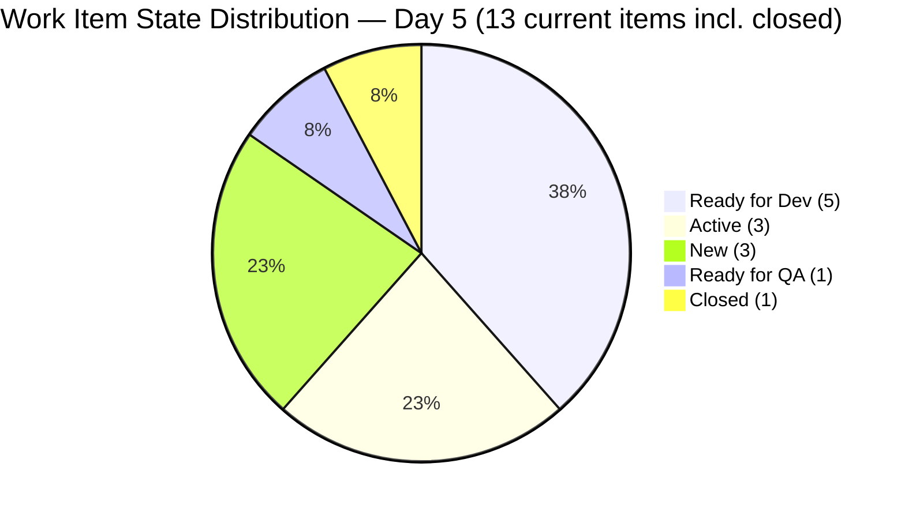
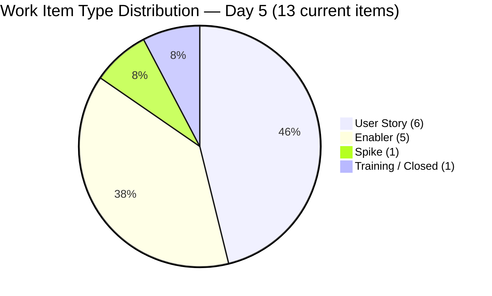
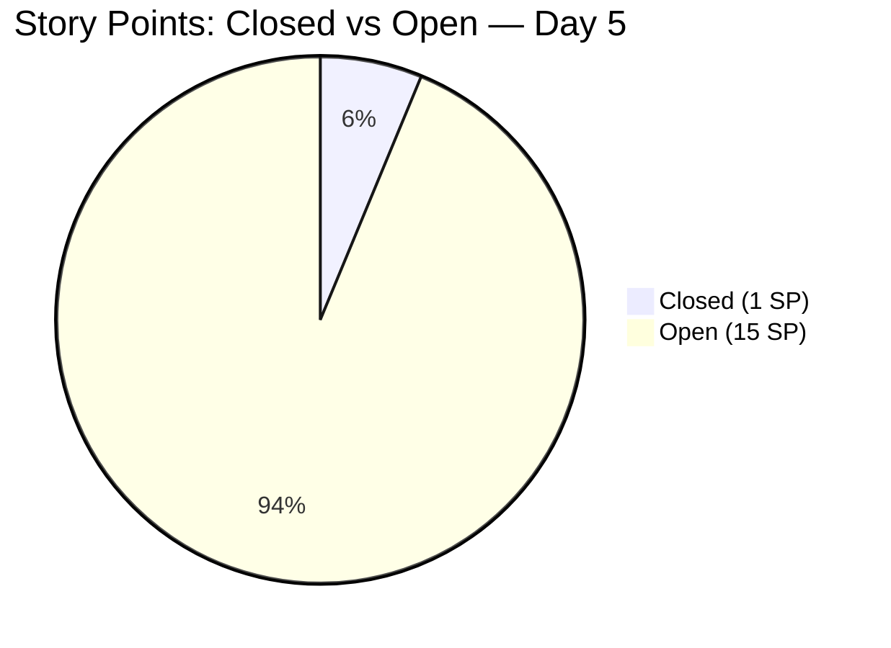
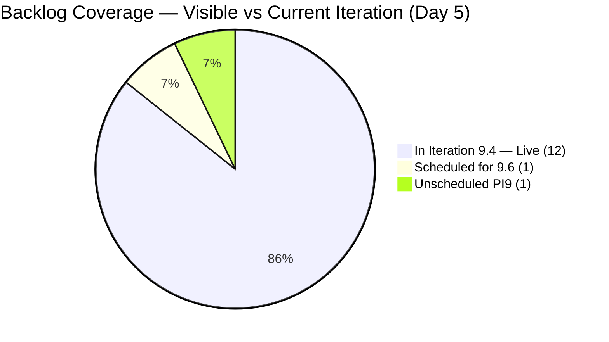

# SAFe Iteration Audit — Human Resource Recruitment Team

## 1. Audit Metadata

| Field | Value |
|-------|-------|
| **Project** | Jairosoft FINOPS |
| **Project ID** | `e0bb302f-40f9-46c3-8164-6f1acb317d63` |
| **Team** | Human Resource Recruitment Team |
| **Team ID** | `248f59a6-372c-4b74-8129-9eaf260f211e` |
| **Workspace** | `ado_hr` |
| **Iteration** | Iteration 9.4 |
| **Iteration ID** | `9205c6ba-a811-479c-9e68-d7bd96c0cc6b` |
| **Iteration Dates** | 2026-11-02 to 2026-11-15 |
| **Audit Date** | 2026-11-06 (Day 5 of 14) — Philippine Standard Time (UTC+8) |
| **Prior Audit Reference** | `audit/AUDIT_20261104_0900.md` — Iteration 9.4 Day 3, Score 80.2 (Low Risk) |
| **Overall Score** | **81.7 / 100** |
| **Risk Band** | LOW (Green) ✅ |

---

## 2. Executive Summary

The Human Resource Recruitment Team enters **Day 5 of 14** of Iteration 9.4 (Nov 2–Nov 15, 2026) with an overall score of **81.7 (Low Risk)** — a **+1.5 point improvement** over Day 3's score of 80.2 (Low Risk). The team holds the Low Risk threshold for the second consecutive audit.

The headline event since Day 3 is the **first sprint closure**: work item #212016 (Onboarding Session w/ HR & JIT CSS Trainer-Donald Macasampon, Training, 1 SP) was closed on November 5. Concurrently, #211995 (JIT CSS Trainer - Donald Macasampon Onboarding, PI9 unscheduled, null SP) was also closed — a long-overdue backlog grooming action that reduces the unscheduled backlog from 2 items to 1. These two closures bring the visible backlog from 16 items (Day 3) to 14 items (Day 5).

Iteration Planning improves to **92.9** (13/14: 12 live + 1 confirmed-closed in Iter 9.4), up from 81.3 (13/16) on Day 3. Backlog Refinement declines to **72.9** (from 80.0) as #208833 crossed the 45-day freshness boundary (Sep 21 → 46 days as of Nov 6) and 4 of 13 items remain pre-sprint-start untouched. Delivery Predictability opens at **6.3** (1 of 16 committed SP closed), ending the 0.0 streak. Five dimensions hold at 100.0: Team Capacity, Estimation, DoR Compliance, and Work Item Balance remain fully locked.

Three Active items (#211991, #212012, #212017) and one Ready for QA (#212424) represent the strongest near-term closure candidates. No iteration goal is defined — a persistent gap across all audits.

---

## 3. Previous Audit Delta

| Dimension | Day 3 (Nov 4, 2026) | Day 5 (Nov 6, 2026) | Delta | Note |
|-----------|---------------------|---------------------|-------|------|
| Iteration Planning | 81.3 | **92.9** | **+11.6** | 211995 closed → D shrinks to 14; 212016 counted in iteration (13/14) |
| Team Capacity | 100.0 | **100.0** | 0 | Almera stable; capacity gap from API acknowledged |
| Estimation | 100.0 | **100.0** | 0 | All 13 items (12 live + 212016 closed) estimated |
| DoR Compliance | 100.0 | **100.0** | 0 | All 13 items DoR-compliant |
| Work Item Balance | 100.0 | **100.0** | 0 | Type mix unchanged — no penalties |
| Backlog Refinement | 80.0 | **72.9** | **-7.1** | 208833 crossed 45-day boundary; base drops from 100 → 92.9 |
| Delivery Predictability | 0.0 | **6.3** | **+6.3** | First closure: 212016 (1 of 16 SP) — Day 5 of 14 |
| **Overall** | **80.2** | **81.7** | **+1.5** | **LOW RISK — holds green threshold** ✅ |

---

## 4. Current Iteration Snapshot

| Field | Value |
|-------|-------|
| **Iteration** | 9.4 |
| **Start Date** | 2026-11-02 |
| **End Date** | 2026-11-15 |
| **Day in Sprint** | Day 5 of 14 |
| **Days Remaining** | 9 |
| **Total Visible Root Backlog Items** | 14 |
| **Root Items in Current Iteration (9.4)** | 13 (12 live + 1 closed: #212016) |
| **Root Items NOT in Current Iteration** | 2 (208833 → 9.6; 211761 → PI9 unassigned) |
| **Closed Items (This Sprint)** | 1 — #212016 (Nov 5) |
| **Active Items** | 3 (211991, 212012, 212017) |
| **Ready for Dev Items** | 5 (211164, 212013, 212014, 212423, 212425) |
| **Ready for QA Items** | 1 (212424) |
| **New Items** | 2 (212045, 212422) |
| **Spike Items** | 1 New (212426) |
| **Story Points Committed** | 16 SP (15 live + 1 from 212016) |
| **Story Points Closed** | 1 SP (212016) |
| **Iteration Goal** | Not defined |

### 4.1 Current Iteration Items — Live (12 items)

| ID | Title | Type | State | SP | Assignee | Changed | DoR |
|----|-------|------|-------|-----|----------|---------|-----|
| 211164 | Pickleball Open Play \| Event Shirt Sizing | User Story | Ready for Dev | 1.0 | Almera | Oct 31 | ✅ |
| 211991 | Luke's 3rd Month Evaluation Result | User Story | Active | 1.0 | Almera | Oct 31 | ✅ |
| 212012 | Pickleball Open Play \| Budget Approval | User Story | Active | 1.0 | Almera | Oct 31 | ✅ |
| 212013 | Pickleball Open Play \| Tshirt Procurement (Davao) | User Story | Ready for Dev | 1.0 | Almera | Nov 2 | ✅ |
| 212014 | Pickleball Open Play \| Tshirt Procurement (Cebu) | User Story | Ready for Dev | 1.0 | Almera | Nov 2 | ✅ |
| 212017 | Collection of 201 Files of JIT CSS Trainer-Donald Macasampon | User Story | Active | 1.0 | Almera | Nov 5 ✨ | ✅ |
| 212045 | Pickleball Open Play \| Tshirt Printing and Delivery | Enabler | New | 1.0 | Almera | Oct 31 | ✅ |
| 212422 | Setup Meeting w/ Bomar & Grace re: Luke's Employment Status | Enabler | New | 1.0 | Almera | Nov 5 | ✅ |
| 212423 | 2027 Leave Policy | Enabler | Ready for Dev | 1.0 | Almera | Nov 4 | ✅ |
| 212424 | 2026 Sick Leave Conversion | Enabler | Ready for QA | 2.0 | Almera | Nov 4 | ✅ |
| 212425 | HR Connect - Sprint 9.4 | Enabler | Ready for Dev | 1.0 | Almera | Nov 4 | ✅ |
| 212426 | CADAC - Letter Submission and Scheduling | Spike | New | 2.0 | Almera | Nov 4 | ✅ |

### 4.2 Closed Items (This Sprint — 1 item)

| ID | Title | Type | State | SP | Closed |
|----|-------|------|-------|----|--------|
| 212016 | Onboarding Session w/ HR \<-\> JIT CSS Trainer-Donald Macasampon | Training | **Closed** ✅ | 1.0 | Nov 5 |

### 4.3 Unscheduled Backlog Items (2 items — reduced from 3)

| ID | Title | Type | State | SP | Iteration | Changed |
|----|-------|------|-------|-----|-----------|---------|
| 208833 | Regularization of Luke Colina | User Story | New | 2.0 | 9.6 (future) | Sep 21 ⚠️ |
| 211761 | Leadership Training | User Story | New | null | PI9 (no iter) | Oct 8 |

> **Note:** #211995 (JIT CSS Trainer - Donald Macasampon Onboarding) was closed on Nov 5. This reduces the unscheduled backlog from 2 items to 1 (211761). Backlog hygiene improving.

### 4.4 State Changes Since Day 3

| ID | Title | Day 3 State | Day 5 State | Changed | Signal |
|----|-------|-------------|-------------|---------|--------|
| 212016 | Onboarding Session (Training) | Ready | **Closed ✅** | Nov 5 | First sprint delivery |
| 211995 | Donald Macasampon Onboarding | New (PI9) | **Closed ✅** | Nov 5 | Backlog groomed |
| 212017 | 201 Files - Donald Macasampon | Ready for Dev | **Active** | Nov 5 | In progress ✨ |
| 212422 | Setup Meeting w/ Bomar & Grace | Ready for Dev | **New** | Nov 5 | ⚠️ State regression |

### 4.5 Contributor Summary

| Contributor | Items (Live) | Capacity (ADO) | Status |
|-------------|-------------|----------------|--------|
| Almera Kleer Tayao | 12 live (+ 1 closed) | 5 pts/day — API returned empty; prior audit data used | Sole contributor — sole deliverer ✅ |
| Grace | 0 | Not configured | Non-contributor this iteration |

---

## 5. Work Item Analysis

### 5.1 Items by State (13 current-iteration items — includes closed)

| State | Count | Items |
|-------|-------|-------|
| Closed | 1 | 212016 ✅ |
| Active | 3 | 211991, 212012, 212017 |
| Ready for Dev | 5 | 211164, 212013, 212014, 212423, 212425 |
| Ready for QA | 1 | 212424 |
| New | 3 | 212045, 212422, 212426 |

### 5.2 Items by Type (13 current-iteration items)

| Type | Count | Share | Dominant? |
|------|-------|-------|-----------|
| User Story | 6 | 46.2% | No (< 60% threshold) |
| Enabler | 5 | 38.5% | — |
| Spike | 1 | 7.7% | — |
| Training | 1 | 7.7% | — (Closed) |

### 5.3 Estimation Coverage

| Category | Count | SP |
|----------|-------|----|
| Estimated (SP > 0) | 13 | 16 SP |
| Closed, estimated (included above) | 1 | 1 SP (212016) |
| Closed this sprint | 1 | 1 SP |
| Remaining open SP | — | 15 SP |

### 5.4 DoR Compliance

All 13 current-iteration items (12 live + 212016 closed) satisfy the Definition of Ready. All 12 live items have confirmed Descriptions ≥ 30 non-whitespace chars and Acceptance Criteria ≥ 20 non-whitespace chars. 212016 was confirmed DoR-compliant in prior audit before closure.

### 5.5 Backlog Refinement Detail

| Category | Count | Notes |
|----------|-------|-------|
| Fresh items (changed within 45 days) | 13/14 | 208833 (Sep 21, 46 days) crossed freshness boundary |
| Stale ≥ 90 days | 0/14 | None; oldest is 208833 at 46 days |
| Stale ≥ 180 days | 0/14 | None |
| Untouched current items (changed before Nov 2) | 4/13 | 211164, 211991, 212012, 212045 — Oct 31 prep work |

> **208833 boundary note:** This item (Regularization of Luke Colina) was last changed Sep 21. At Day 3 (Nov 4) it was 44 days old — fresh. At Day 5 (Nov 6) it is 46 days old — no longer fresh per the 45-day threshold. This is a mechanical boundary crossing, not a grooming deterioration. Touching or reassigning 208833 to a specific iteration would restore freshness.

---

## 6. SAFe Compliance Scorecard

| Dimension | Score | Formula | Evidence |
|-----------|-------|---------|----------|
| Iteration Planning | **92.9** | (13/14) × 100 | 12 live + 1 closed in 9.4; 2 items outside iteration (208833 → 9.6, 211761 → PI9) |
| Team Capacity | **100.0** | (1/1) × 100 | Almera configured 5 pts/day; sole contributor; capacity API empty — prior audit data used |
| Estimation | **100.0** | (13/13) × 100 | All 13 current-iteration items have SP > 0 (total 16 SP committed) |
| DoR Compliance | **100.0** | (13/13) × 100 | All 13 items have Desc ≥ 30 + AC ≥ 20 |
| Work Item Balance | **100.0** | 100 − 0 | US = 46.2% (< 60%), Spike = 7.7% (< 40%) — no penalties |
| Backlog Refinement | **72.9** | 92.9 − 20 | 208833 stale: base 92.9 (13/14 fresh); 4/13 untouched (30.77% > 30%) → −20 |
| Delivery Predictability | **6.3** | (1/16) × 100 | 1 SP closed (212016); Day 5 of 14 — first sprint closure |
| **Overall** | **81.7** | Sum / 7 | **LOW RISK (Green)** ✅ |

---

## 7. Dimension Findings

### 7.1 Iteration Planning — 92.9 (Low Risk ✅ — Improved from 81.3)

Iteration Planning reaches its highest score in the ado_hr audit series: 13 of 14 visible backlog items are committed to Iteration 9.4. The improvement is driven by two closures on Nov 5: #211995 (PI9 unscheduled, null SP) was closed — permanently removing it from the unscheduled backlog — and #212016 (Training, 1 SP) was closed within the iteration. The visible backlog shrunk from 16 to 14 items.

**Backlog composition (14 visible items):**
- 12 items: active/open in Iteration 9.4
- 1 item: closed in Iteration 9.4 (212016) — counted in iteration commitment
- 1 item: scheduled to Iteration 9.6 (208833 — intentional forward planning)
- 1 item (not in denominator): unscheduled in PI9 (211761 — Leadership Training, ungroomed)
  Wait — 211761 IS in the 14 visible items (it's still open). Let me recount:
  
  14 visible items = 12 live 9.4 + 208833 (9.6) + 211761 (PI9) = 14 items. That's the visible backlog.
  Plus 212016 is closed, so the committed count in 9.4 is 12+1 = 13 of 14 total seen.

Achieving 93%+ Iteration Planning represents excellent sprint scope discipline. The last unscheduled item (#211761 Leadership Training) has no SP, description, or AC — grooming or closure is recommended by mid-sprint to push this score toward 100.0.

### 7.2 Team Capacity — 100.0 (Strong ✅ — Stable)

Almera Kleer Tayao continues as the sole contributor. The ADO Capacity API returned an empty response for this iteration (a known API behavior when capacity is configured through the team settings UI rather than the API). Prior audit evidence confirms 5 pts/day (Documentation: 3.0 + Requirements: 2.0). With 15 SP remaining (open) and 9 days left, the theoretical pace needed is ~1.67 SP/day — well within Almera's 5 pt/day throughput.

Day 5 shows three Active items (211991, 212012, 212017), which suggests work has begun and delivery cadence may accelerate in the coming days.

### 7.3 Estimation — 100.0 (Strong ✅ — Stable)

All 13 current-iteration items (12 live + 212016 closed) carry Story Points > 0. Total committed: 16 SP. The 212016 closure reduces open SP from 15 to 14 remaining (after the 1 SP close). The two 2-SP items (212424, 212426) indicate some deliberate effort sizing — a positive pattern established since Day 3 additions.

### 7.4 DoR Compliance — 100.0 (Strong ✅ — Stable)

All 13 current-iteration items satisfy the Definition of Ready. DoR discipline has been maintained throughout all sprint additions since Day 1 of this iteration. The closure of 212016 confirms that items prepared with proper DoR (Desc + AC) can be successfully closed within the sprint, validating the team's pre-sprint preparation practice.

### 7.5 Work Item Balance — 100.0 (Strong ✅ — Stable)

The type distribution is unchanged from Day 3: User Stories at 46.2%, Enablers at 38.5%, Spike at 7.7%, Training at 7.7%. All penalty thresholds remain unbreached. The closure of the Training item (212016) does not change the dominant type (US remains 46.2%). If Training is excluded from the balance calculation after closure, the remaining 12 open items are: 6 US (50%), 5 Enabler (41.7%), 1 Spike (8.3%) — still well within SAFe balance thresholds.

The sprint continues to reflect contextually appropriate diversity for an HR function: operational (Pickleball coordination), compliance (Leave Policy, Sick Leave Conversion, CADAC), people management (Luke's evaluation), and onboarding work (201 files).

### 7.6 Backlog Refinement — 72.9 (Moderate — Degraded from 80.0)

The decline from 80.0 to 72.9 is explained by one mechanical event: **#208833 crossed the 45-day freshness boundary.**

- Day 3 (Nov 4): Sep 21 → 44 days old → fresh ✓
- Day 5 (Nov 6): Sep 21 → 46 days old → NOT fresh ✗

This is not a team failure — the item (Regularization of Luke Colina) is intentionally scheduled to Iteration 9.6 and represents planned future work. The boundary crossing is a scoring artifact of the 45-day threshold rule. Any update to the item (a note, an assignee, a date adjustment) would restore freshness and lift the base score from 92.9 back to 100.0, raising Backlog Refinement from 72.9 to ~80.0 (still subject to the untouched penalty).

Untouched current items: **4 of 13 (30.77%)** — still above the 30% threshold by a slim margin.
- Untouched (changed before Nov 2): 211164, 211991, 212012, 212045 (all Oct 31 prep work)
- 212017 moved to Active (Nov 5 touch), breaking the Oct 31 group from 5 → 4 items
- 212016 (Oct 31 at Day 3, now closed Nov 5) is no longer in untouched count

The untouched penalty (-20) will likely resolve naturally by Day 7–8 as Almera executes against the Oct 31-prepped items (211164 shirt sizing, 211991 Luke eval, 212012 budget approval, 212045 shirt printing dispatch).

### 7.7 Delivery Predictability — 6.3 (Day 5 of 14 — First Closure)

One SP closed: **#212016 (Onboarding Session w/ HR & JIT CSS Trainer-Donald Macasampon, Training, 1 SP)** — closed Nov 5.

Burn rate: 1 SP in 4 days (Day 1–4) = 0.25 SP/day. This is below the pace required to close all 15 remaining SP (1.67 SP/day needed over 9 remaining days), but early-sprint delivery patterns for this team historically show burst closes. At Day 3, the recommendation noted that **#212424 (Sick Leave Conversion, Ready for QA, 2 SP)** is the next logical closure — it remains in that state, unchanged since Nov 4.

**Early-sprint annotation: Day 5 of 14 — delivery cadence opening.**

Delivery feasibility with 9 remaining days:

| Target | SP to close | Days available | Feasibility |
|--------|-------------|----------------|-------------|
| 50% (8 SP total → 7 more) | 7 SP | 9 | High |
| 75% (12 SP total → 11 more) | 11 SP | 9 | Moderate-High |
| 100% (16 SP total → 15 more) | 15 SP | 9 | Feasible at ~1.67 SP/day |

Almera's historical peak (23 SP in a single day in PI6) confirms feasibility, but that was a sprint close burst. A steady 2 SP/day pace beginning Day 6 delivers all 16 SP by Nov 15.

---

## 8. Risks and Bottlenecks

| Risk | Severity | Details |
|------|----------|---------|
| Bus Factor = 1 | HIGH | All 13 items (12 live + 1 closed) owned by Almera Kleer Tayao. No backup. 15 SP open, 9 days remaining. Any absence now blocks all remaining delivery. Structural — unchanged. |
| Backlog Refinement Decline | MODERATE | 208833 crossed 45-day freshness boundary. If untouched for another 2 days, Backlog Refinement holds at 72.9. A single update to 208833 restores freshness and lifts the score. |
| 212424 (Ready for QA) Still Unresolved | MODERATE | The highest-SP (2 SP) closure candidate has been in Ready for QA since Day 3 (Nov 4). No state change in 2 days. If QA review is complete, closing this item today opens Delivery Predictability to 3/16 = 18.75%. |
| 212422 State Regression | MODERATE | #212422 (Setup Meeting w/ Bomar & Grace) regressed from Ready for Dev → New (changed Nov 5). This is unusual and may indicate a re-scope, blockers discovered, or a workflow error. Requires Almera or Ramon to investigate and reclassify. |
| Delivery Predictability Gap | MODERATE | Only 1 SP closed by Day 5. At current pace (0.25 SP/day), projected close by Day 15 is 3–4 SP. Burst closure behavior needed in second half of sprint (Day 7–14). |
| 211761 Persistent Ungroomed | LOW | Leadership Training: still unscheduled (PI9), null SP, no description, no AC. 4th consecutive audit with this item ungroomed. Close or schedule to 9.5/9.6. |
| 208833 Needs Attention | LOW | Regularization of Luke Colina scheduled to 9.6. No update since Sep 21. Requires a review before 9.6 begins — particularly given the Luke evaluation (211991) is Active in this sprint and may feed regularization decisions. |

---

## 9. Prioritized Recommendations

| Priority | Action | Owner | Target |
|----------|--------|-------|--------|
| P0 | Close **#212424** (2026 Sick Leave Conversion — Ready for QA, 2 SP) today if QA review is complete. This opens Delivery Predictability from 6.3 → 18.75% (3/16 SP). | Almera | Day 5 |
| P0 | Investigate **#212422 state regression** (Ready for Dev → New). Confirm whether a blocker exists, re-scope is needed, or this is a workflow error. Reclassify appropriately. | Almera | Day 5 |
| P1 | Touch **#208833** (Regularization of Luke Colina) with any update — a note on Luke's evaluation progress, an assignee confirmation, or a 9.6 planning note. Any change restores 45-day freshness and lifts Backlog Refinement from 72.9 to ~80.0. | Ramon | Day 5–6 |
| P1 | Begin closing **#211991** (Luke's 3rd Month Evaluation — Active) now that the evaluation meeting (#212422) should be in progress. If the meeting is happening, the evaluation form sign-off may be ready by Day 7. | Almera | Day 5–7 |
| P1 | Define an **iteration goal** for 9.4 — suggested: "Complete Pickleball event coordination, HR policy documentation, and JIT CSS onboarding & compliance." | Ramon | Day 5 |
| P2 | Schedule **#211761** (Leadership Training) to Iteration 9.5 or 9.6, or close it. 4 consecutive audits ungroomed. No SP, Desc, or AC. | Ramon | Day 6 |
| P2 | Establish a **mid-sprint velocity check on Day 7 (Nov 9)**. With 15 SP remaining and 9 days, confirm closure cadence will clear the full commitment. If pace is insufficient by Day 7, consider scope reduction or reprioritization. | Ramon | Day 7 |
| P3 | Add a second contributor for PI10 planning. 15 SP on a single person with no backup remains a structural risk that is amplified as sprint scope grows. | Ramon | PI10 planning |

---

## 10. Evidence Gaps and Limitations

| Gap | Impact | Status |
|-----|--------|--------|
| Capacity API returned empty | No scoring impact; Almera's 5 pts/day confirmed from prior audit. Score uses prior-audit evidence. | Documented. Standard API behavior when team capacity is UI-configured. |
| 212016 (closed) tracked via manual item lookup | 212016 dropped from backlog API after closure; directly queried by ID to confirm state and SP. Confirmed: Closed Nov 5, 1 SP, Iteration 9.4. | Resolved via secondary query. |
| 211995 (closed) tracked via manual item lookup | Same as above: closed Nov 5, null SP, PI9 (unscheduled). No scoring impact (null SP, not in current iteration). | Resolved via secondary query. |
| Grace remains unconfigured (0 capacity, 0 items) | No scoring impact; informational only. | Noted. No change from previous audits. |
| 212422 state regression (Ready for Dev → New) | Noted as risk. No scoring impact (item remains estimated, DoR-compliant, in current iteration). | Documented. Requires team investigation. |
| Closed items drop from live backlog API view | Standard limitation. This audit mitigates via manual lookups for known dropped items (212016, 211995). Future audits may miss closures between runs. | Mitigated this run. Standard limitation per rubric. |

---

## Appendix: Visualizations

```mermaid
bar
    title SAFe Dimension Scores — HR Team Iteration 9.4, Day 5 (2026-11-06)
    x-axis [Iter Plan, Team Cap, Estimation, DoR, WI Balance, Backlog Ref, Delivery]
    y-axis "Score (0–100)" 0 --> 100
    bar [92.9, 100, 100, 100, 100, 72.9, 6.3]
```









```mermaid
xychart-beta
    title Audit Score Trend — ado_hr (Recent PI9)
    x-axis ["Mar 22 (6.5)", "Nov 3 (9.4 D2)", "Nov 4 (9.4 D3)", "Nov 6 (9.4 D5)"]
    y-axis "Overall Score" 0 --> 100
    line [80, 74.7, 80.2, 81.7]
```
